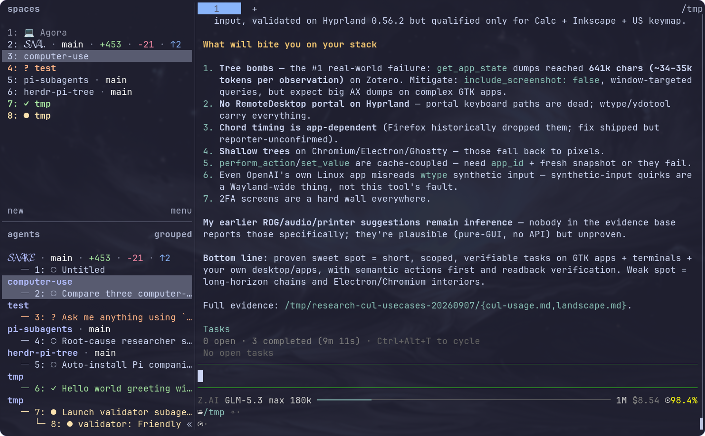

# Herdr Pi Tree

Tree sidebar for Pi agents in Herdr: nested subagents, worktree branches,
colored git stats, and focus indices. A resident Node daemon renders sidebar
and tab-bar tokens over Herdr's socket API; managed blocks in Herdr's
config.toml carry the theme and sidebar rows. Zero runtime dependencies.



## Install

```bash
herdr plugin install edxeth/herdr-pi-tree
```

The install build writes the managed blocks and starts the daemon; the
`unconfigure` action removes everything before uninstalling.

You can read my own `config.toml` as an example:
[Herdr config with the plugin blocks](https://gist.github.com/edxeth/d664d742aa6e98458d60ca2748b54151).
The gist shows the three blocks in place with my keybindings and theme.

## The Pi companion extension

A Pi companion extension ships here and installs into your Pi directory
when the plugin sets up. It shows `?` for supported agent questions,
including recovered unanswered questions and refusal choices. Menus and
replay forms you open yourself do not change a working agent to blocked.

The components that display these questions work without this plugin and
need no patches. The companion only adds their waiting-status display in
Herdr. It uses existing version-1 question notifications and recognizes a
supported refusal selector's caller and registered source files. It does
not infer waiting from menu wording or a period of inactivity. If that
caller is renamed, moved or bundled with renamed functions, this plugin's
adapter needs an update. Unrecognized dialogs are left alone.

The companion refreshes its managed copy when the plugin runs its setup
or state actions. Reload Pi to load a refreshed copy. `unconfigure`
removes the managed file. To prevent its first installation, set
`auto_install_pi_extension` to `false` in the settings popup; an existing
managed copy still receives updates.

## Subagents

Optional. Subagent panes nest under the agent that spawned them, with
their handles, when the spawner names each child session's parent.
[pi-subagents](https://github.com/edxeth/pi-subagents) does exactly that —
with it, subagents appear in the tree to their true depth. Without a
spawner, everything else (worktrees, git stats, states, Spaces) works
unchanged.
